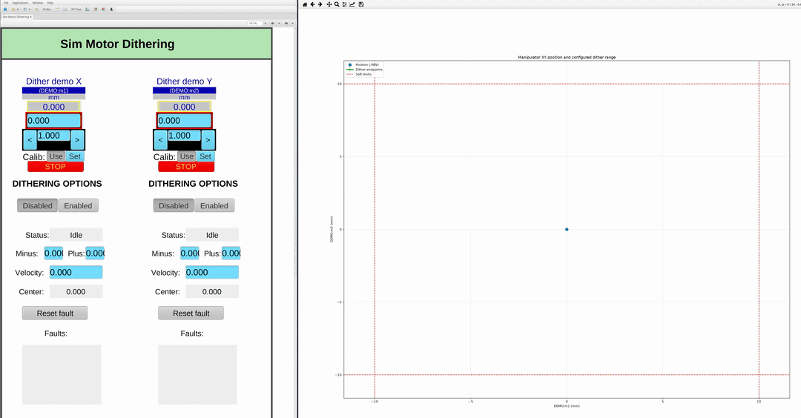

# EPICS motor dither record


The dither record is an EPICS record for _dithering_ - oscillating an existing motor record around its setpoint for the purposes of beam protection.

## Purpose of Dithering

**If your beam is smaller than your sample, why fry your sample?**



With spectroscopy scans of certain types of techniques e.g absorption, electrocatalysis, the sample is damaged over time by the x-ray beam as it is being measured. Certain samples can be protected by "dithering" the manipulator motor - periodically moving about it's set point in the center of the sample to spread out the surface being measured during the experiment.

## Operation

A dither record `$(P):DITHER` can be supplied for any epics motor record `$(P)`.

| PV | Meaning |
| --- | --- |
| `$(P):DITHER` | The amount the motor is currently dithered - the motor `.RBV` minus `.CEN` (read-only). |
| `$(P):DITHER.STATE` | One of `Idle`, `Dithering`, `Returning`, `Fault` (read-only). |
| `$(P):DITHER.START` | Write 1 to start dithering (accepted only from `Idle`). |
| `$(P):DITHER.STOP` | Write 1 to stop and return to the center (wins over `.START`; also clears a fault). |
| `$(P):DITHER.PLUS` | Distance above `.CEN` in the motor should travel while dithering, at least 0. On set `.ABS` is set to `.MINUS + .PLUS`. |
| `$(P):DITHER.MINUS` | Distance below `.CEN` the motor should tracel while dithering, at least 0. On set `.ABS` is set to `.MINUS + .PLUS`. |
| `$(P):DITHER.ABS` | Total range to dither on this axis. On set `.MINUS = .PLUS = .ABS / 2` is set. |
| `$(P):DITHER.VELO` | Positive dither velocity in motor user units per second. |
| `$(P):DITHER.CEN` | Center of the dither (read-only). Follows the motor `.VAL` while not dithering, and follows any new `.VAL` put to the motor during dithering. |
| `$(P):DITHER.ERR` | Last fault description (read-only). Kept until the next fault replaces it, and cleared when dithering starts successfully again. |

## Important Notes

* After dithering is stopped a motor record will always return to `.CEN`.
* Acceleration is the same as the motor acceleration, e.g `.ACCS` of the motor.
* If a different `.VAL` is put to the motor by the user during dithering, the motor moves there and then dithers about that new value: `:DITHER.CEN`.
* To recover from a fault (a `.STATE` of `Fault`, with `.ERR` saying why) write 1 to `:DITHER.STOP`. Once the motor has stopped the state returns to `Idle` and dithering can be started again.
* **Use soft limits!** Soft limits are respected by the dither record. If the dither is on the boundary then the movement will take place up until the soft limit, but not move over. If the soft limits change to inside the dither radius during dithering then a fault will be made and dithering will stop.


## Build and integrate

1) Create a `RELEASE.local` with `EPICS_BASE` and `MOTORDITHER` set to this directory.

2) Add `motorDither.dbd` the dbd and `motorDither` to the libs of your IOC:

3) Before `iocInit` but after loading the motor record, load:

```iocsh
dbLoadRecords("$(MOTORDITHER)/db/motorDither.db", "P=IOC:m1")
```

Replace `IOC:m1` with your EPICS motor record.


## Simulator example

The example directory contains:

* [st.cmd`](sim_motor_example/st.cmd) for starting two simulation axes.
* [`plot_trajectory.py`](sim_motor_example/plot_trajectory.py) for live plotting the simulation axes trajectory.
  - [`requirements.txt`](sim_motor_example/requirements.txt) for live plotting.
* [`top.bob`](sim_motor_example/top.bob) for setting values through phoebus.


Simply run:

``` bash
cd sim_motor_example/
pip -r requirements.txt
$MOTOR_SIM_DIRECTORY/iocs/motorSimIOC/bin/linux-x86_64/motorSim st.cmd
python plot_trajectory.py
```
